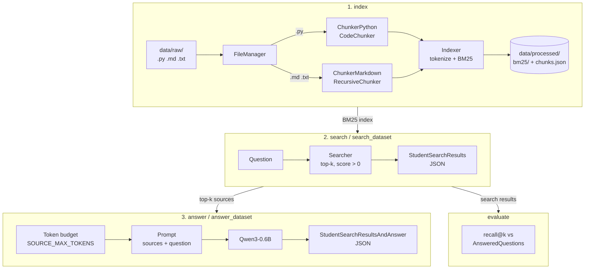

*This project has been created as part of the 42 curriculum by [flinguen](https://linguenheld.net/)*

# 42_rag
RAG against the machine. Will you answer my questions?

## Description

A Retrieval-Augmented Generation system that answers questions about the
vLLM 0.10.1 codebase. It indexes the repository (Python, Markdown and text
files), retrieves the most relevant snippets for a question with BM25, and
asks the small local model `Qwen/Qwen3-0.6B` to answer using only those
snippets.

## Instructions

This project uses [uv](https://docs.astral.sh/uv/).

On the 42's computers, the session space is limited: first put the virtual
environment, the uv cache and the Hugging Face models in the *goinfre* folder.
The script has to be **sourced** (not executed), in every new terminal:

```Bash
source export_to_goinfre.sh      # bash / zsh
source export_to_goinfre.fish    # fish
```

```Bash
make install    # uv sync
make lint       # flake8 + mypy
make clean      # __pycache__, .mypy_cache
make fclean     # clean + uv cache, venv and model
```

Commands (`uv run python -m src <command> --help` for details):

```Bash
uv run python -m src index --max_chunk_size 2000
uv run python -m src search "How to load a LoRA adapter?" --k 5
uv run python -m src answer "How to load a LoRA adapter?" --k 5

uv run python -m src search_dataset \
  --dataset_path data/datasets/UnansweredQuestions/dataset_docs_public.json \
  --k 10 \
  --save_directory data/output/search_results/UnansweredQuestions

uv run python -m src evaluate \
  --student_search_results_path data/output/search_results/UnansweredQuestions/dataset_docs_public.json \
  --dataset_path data/datasets/AnsweredQuestions/dataset_docs_public.json

uv run python -m src answer_dataset \
  --student_search_results_path data/output/search_results/UnansweredQuestions/dataset_docs_public.json \
  --save_directory data/output/search_results_and_answer/UnansweredQuestions
```

## System architecture



- **`src/chunking/`**: reads `data/raw/` and splits each file into chunks
  (file path + character range).
- **`src/indexing/`**: tokenizes the chunks, builds and saves the BM25 index;
  `Searcher` loads it and returns the top-k chunks of a question.
- **`src/answering/` + `src/llm/`**: builds the prompt from the retrieved
  sources and generates the answer.
- **`src/evaluation/`**: recall@k against a ground-truth dataset.
- **`src/commands.py`**: the CLI (Python Fire). Every expected error raises a
  `CommandError` with a clear message: the CLI never crashes with a traceback.

## Chunking strategy

Two strategies, both from [Chonkie](https://docs.chonkie.ai/), with chunks of
at most `--max_chunk_size` characters (default and maximum: 2000):

- **Python**: `CodeChunker` uses the tree-sitter syntax tree, so a chunk never
  cuts a function or a class in the middle (unless it is too long).
- **Markdown / text**: `RecursiveChunker` with the `markdown` recipe: it splits
  on headers first, then paragraphs, lines and sentences, and merges
  consecutive pieces up to the chunk size. Markdown chunks are capped at
  1500 characters (`MARKDOWN_MAX_CHUNK_SIZE`): the recipe packs sections
  together up to the chunk size, and smaller chunks fit the short doc
  sections better.

Text files (`*.txt`) are indexed too: `CMakeLists.txt` holds the build
requirements (CUDA versions, architectures) and `requirements/*.txt` the
dependencies.

## Retrieval method

- **Tokenizer**: lowercase identifiers, plus their `snake_case` / `camelCase`
  parts, so `max_chunk_size` also matches "max chunk size". Punctuation is
  dropped.
- **Ranking**: BM25 ([bm25s](https://github.com/xhluca/bm25s)). The top-k
  chunks are returned by decreasing score.
- **Filtering**: chunks with a score of 0 share no word with the question and
  are dropped, so an empty or nonsensical question returns no source.

## Performance analysis

Recall@k measured by the moulinette on the public datasets (k=10):

| Index (`max_chunk_size`, files) | docs @1 | @3 | **@5** | @10 | code @1 | @3 | **@5** | @10 |
|---|---|---|---|---|---|---|---|---|
| 2000, py + md | 59.0 | 73.0 | 78.0 | 82.0 | 46.5 | 63.6 | 70.7 | 78.8 |
| 1500, py + md | 62.0 | 75.0 | 80.0 | 83.0 | 45.5 | 58.6 | 67.7 | 73.7 |
| 1000, py + md | 59.0 | 73.0 | 78.0 | 82.0 | 44.4 | 55.6 | 65.7 | 72.7 |
| 2000, py + md + txt | 60.0 | 77.0 | 81.0 | 85.0 | 46.5 | 62.6 | 70.7 | 78.8 |
| **2000, py + md + txt, md capped at 1500** | **63.0** | **78.0** | **83.0** | **86.0** | **46.5** | **63.6** | **69.7** | **78.8** |

Targets: 80 % recall@5 on docs, 50 % on code.

- Smaller chunks help docs up to 1500, then hurt; they always hurt code (a
  function split in pieces loses its context). Hence 1500 for Markdown only,
  Python keeps `--max_chunk_size`.
- Indexing `*.txt` fixes the 3 docs questions answered by `CMakeLists.txt`.
- Remaining misses: very short reference spans (< 100 chars) cannot reach the
  0.05 IoU with ~2000-char chunks, and the large model tables of
  `supported_models.md` rank poorly with BM25.

Speed (AMD Ryzen 7 7735HS, no GPU, `exam_retrieval.sh`): indexing 15 s,
200 questions searched in 6 s, answer ~10-20 s per question.

## Design decisions

- **BM25 only**: fast, no embedding model to download, and good on code
  identifiers thanks to the tokenizer.
- **Source token budget (`SOURCE_MAX_TOKENS = 3000`)**: sources are added in
  rank order until the budget is full. The correct source is in the prompt
  for 84 % (docs) / 74 % (code) of the questions, against 81 / 69 at 2000 and
  85 / 78 at 4000. With 10 sources, the 0.6B model gets distracted by the
  irrelevant ones, so 3000 is the balance.
- **Prompt**: the model only writes the answer text, "using only the sources
  above", and must say when it does not know. Thinking mode is disabled and
  decoding is greedy, for reproducible answers.
- **dtype**: `bfloat16` on GPU, `float32` on CPU: without bf16 instructions,
  bfloat16 is emulated and was ~3x slower.
- **Robustness**: missing source files are skipped, the save folder is
  checked before the slow LLM loop, and inputs are validated with pydantic.

## Resources

- [vLLM documentation](https://docs.vllm.ai/en/latest/)
- [Retrieval-Augmented Generation (Lewis et al., 2020)](https://arxiv.org/abs/2005.11401)
- [Okapi BM25](https://en.wikipedia.org/wiki/Okapi_BM25) and [bm25s](https://github.com/xhluca/bm25s)
- [Chonkie](https://docs.chonkie.ai/)
- [Qwen3](https://huggingface.co/Qwen/Qwen3-0.6B) and [Transformers](https://huggingface.co/docs/transformers)

### AI usage

Claude (Claude Code) was used as a reviewer and pair programmer:
